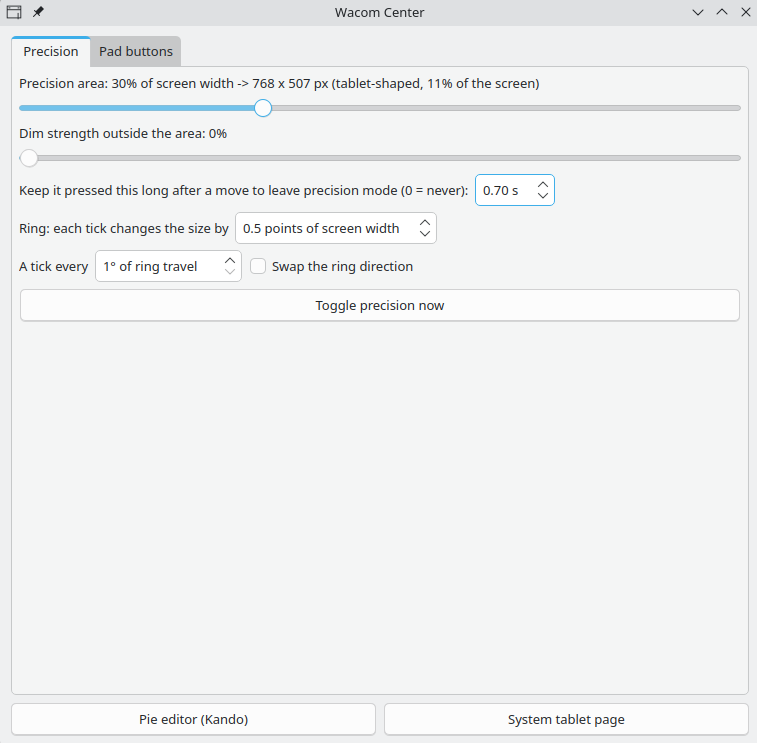
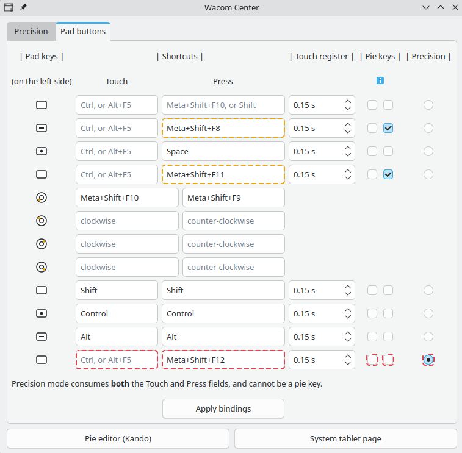

# Custom Drawing Tablet Center

This is a settings app and toolkit for drawing tablets, made for KDE Plasma 6
on Wayland. Wacom makes no settings app for Linux. Linux has the driver, and
Plasma's Drawing Tablet page sets the basics: the screen area, the pressure
curve and the buttons. The page has no precision mode. This project adds
one, plus quality-of-life changes to what the tablet already does.

Built and tested on Kubuntu 26.04 with Plasma 6.6 and a Wacom Intuos Pro M,
over Bluetooth and USB. Precision mode and the ring work through Plasma's
own tablet settings, so other tablets can work too, but nobody has tested
one yet. The touch preview, the area drag, the touch chords and the pie
menu under the pen need pad keys that sense a resting finger (Wacom calls
these keys ExpressKeys).

## What it does

- **Precision mode.** Press a pad key. The pen now maps to a small area
  around the cursor, for detail work. Press the key again to get the full
  screen back. The cursor does not jump, and the screen outside the area
  dims. The area has the shape of your tablet, so your strokes keep their
  proportions.
- **Touch preview.** Rest a finger on the precision key. A ghost shows where
  the area will land, and it follows the pen.
- **Area drag.** With precision mode on, rest a finger on the precision key
  and move the pen. The area follows the pen. Press the key to put the area
  there. Keep the key pressed to leave precision mode.
- **Ring size control.** Turn the touch ring clockwise to make the area
  bigger, counter-clockwise to make it smaller. With precision mode off, a
  preview shows the new size. With it on, the area itself grows or shrinks
  in place.
- **Pie menu under the pen.** A pad key opens a [Kando](https://kando.menu)
  pie menu at the pen, not where the mouse was left.
- **Touch chords.** Rest a finger on a pad key, and the key holds a chord
  for you: rest for Ctrl while you sculpt in Blender, lift to release.
- **Tablet Center, one settings window.** The area size, the dim strength,
  the times, the ring's four modes, every pad key, and the pen's buttons
  and pressure curve, all in one place.
- **Profiles.** Save your settings as a profile, and switch between
  profiles with one click.
- **Left-handed use.** Use the tablet turned around, with the keys on the
  right. One box sets left-handed mode for the cable and for Bluetooth.

## In pictures

https://github.com/user-attachments/assets/5c04b1b3-ea14-4669-b458-18271664d768

<p align="center"></p>

Precision mode on, with a reference photo in Gwenview and the drawing in
Krita. The pen maps to the area with the amber border.

<p align="center"> </p>

Tablet Center. Left, the Precision tab. Right, the Pad buttons tab.

## Requirements

- KDE Plasma 6.5 or newer, on Wayland. This project does not work on X11.
  On X11, use `xsetwacom` instead.
- [Kando](https://kando.menu), if you want the pie menu.

## Install

On Kubuntu, Ubuntu and Debian, install the package. On other systems, use
the install script.

### With the package (Kubuntu, Ubuntu, Debian)

If you used the install script before, run `./uninstall.sh` in its folder
first. Your settings and your profiles stay.

A finished package is on the Releases page of this repository. Download
`plasma-tablet-center_1.0.0_all.deb`, then run
`sudo apt install ./plasma-tablet-center_1.0.0_all.deb` in the folder with
the file, and go on with step 3. A package from before the rename replaces
itself, and your profiles are copied at the first start.

1. In a terminal, get the files:

   ```
   git clone https://github.com/lugi-ow/plasma-tablet-center
   cd plasma-tablet-center
   ```

2. Build the package and install it:

   ```
   sudo apt install "$(bash packaging/build-deb.sh)"
   ```

   The package also installs the packages that it needs and a permission
   rule. The rule lets the toolkit read the pen and the pad keys.

3. Open Tablet Center from the application menu. At the first start, it
   sets up the shortcuts, starts the pad helper and shows what it did. If
   a tablet is connected, it also asks to bind the touch ring.

4. In the Pad buttons tab, tick the round Precision box of the pad key
   that you want as the precision key.

5. Click "Apply bindings".

The shortcuts and the pad helper work at once. You do not have to log out.

### With the install script (other systems)

1. Install the three packages that the toolkit needs. On Kubuntu, Ubuntu
   and Debian, run:

   ```
   sudo apt install python3-pyqt6 python3-pyqt6.qtquick qml6-module-org-kde-layershell
   ```

   On other systems, install the same three packages under their own
   names. Without the third one, precision mode works, but no border and
   no dim show.

2. In a terminal, run:

   ```
   git clone https://github.com/lugi-ow/plasma-tablet-center
   cd plasma-tablet-center
   ./install.sh
   ```

   If a tablet is connected, the installer asks to bind the touch ring.
   At the end, it prints the steps that need you.

3. Run the `sudo` command that the installer prints. It adds the same
   permission rule as the package.

4. Open Tablet Center from the application menu.

5. In the Pad buttons tab, tick the round Precision box of the pad key
   that you want as the precision key.

6. Click "Apply bindings".

7. Log out and log in again. This starts the touch preview and makes the
   shortcuts work.

## Update

1. Close Tablet Center if it is open.

2. In the folder you cloned, get the new version and install it again.
   With the package:

   ```
   git pull
   sudo apt install "$(bash packaging/build-deb.sh)"
   ```

   With the install script:

   ```
   git pull
   ./install.sh
   ```

   Your settings and your profiles stay.

3. Restart the pad helper, so it runs the new code:

   ```
   systemctl --user restart 'app-tablet\x2dhover@autostart.service'
   ```

   A logout and login also restarts it.

## The precision key

The precision key is the pad key with the ticked Precision box in the Pad
buttons tab. Its row shows red moving outlines: precision mode owns that
key, and its Touch and Press fields do nothing else. Untick the box to
switch off the ghost and the drag.

| Precision mode | What you do | What happens |
|---|---|---|
| off | press the key | precision mode comes on, around the cursor |
| off | rest a finger on the key | a ghost shows where the area will land, and follows the pen |
| on | press the key at once | precision mode goes off |
| on | rest a finger for the key's Touch register, then press | the area moves to the pen |
| on | rest a finger, then lift it without a press | nothing changes |
| on | rest a finger, press, and keep the key down for the long-press time | the area moves, then precision mode goes off |

The Touch register is the key's own time field in the Pad buttons tab. The
long-press time is in the Precision tab. With the register at 0, every
press is a move, and the long press is the way out of precision mode.

If the tablet disconnects while precision mode is on, the mode switches off
after 10 seconds. If the tablet comes back within the reconnect time (60
seconds, in the Precision tab), the mode comes back in the same place.

## Settings

Open Tablet Center from the application menu, in the Settings category.

The Precision tab sets the area: its size and size limits, the dim
strength, the long-press and reconnect times, and the ring's step and
direction. The Pad buttons tab shows the whole pad as a table: each key's
Touch and Press shortcuts, the ring's four modes, the pie keys and the
precision key. Hover over a column title for its explanation.

Bind pad keys to F-keys and modifiers. Letters and digits do not work while
a non-Latin keyboard layout is active.

## Pen

The Pen tab has the same pen settings as System Settings > Drawing Tablet:
the buttons, the pressure curve and the pressure range. With them in Tablet
Center, the pen and the pad share one window.

- Pen buttons 1 and 2 work like the pad key boxes: type a shortcut, leave
  the box empty, or type "Disabled" to switch the button off.
- Pen button 3 is both side buttons pressed together. It works only over
  USB, and some pens do not have it.
- A button that System Settings binds to a mouse button shows read-only
  here. Change it in System Settings. Tablet Center never clears a binding
  that it did not set.
- The tab works with the pen away. Click "Apply", and the settings take
  effect when the pen connects.

## Left-handed use

To use the tablet turned around, with the keys on the right, tick the
Left-handed box at the top of the Pad buttons tab. Tablet Center sets it for
the cable and for Bluetooth at once. The same box in System Settings >
Drawing Tablet sets only the connection in use. The change starts when you
next lift the pen.

The precision area, the touch preview, the pie menus and the Pad buttons
table turn with the tablet. The ring keeps its directions: clockwise stays
clockwise.

## Profiles

A profile is a saved copy of every setting on the Precision, Pad buttons
and Pen tabs. Pie menus stay in Kando, so they are not part of a profile.

In the Profiles tab:

- The button at the top names the profile in use. Click it to search the
  list and switch. The "+" button next to it adds a profile from a file.
- Click a cell in the grid of nine to switch to its profile at once.
  "Edit Grid" changes the cells and their pictures.
- "Export All Current Settings as Profile..." saves your setup as a new
  profile file, to back it up or to share it.

A switch never turns precision mode on or off. The first time you change a
profile in a session, Tablet Center keeps one backup of it. Your profiles
stay after an uninstall.

## Pie menu

Plasma has no pie menus. [Kando](https://kando.menu) adds them, and it
works on Plasma Wayland. `examples/kando-krita-menu.json` is a Krita menu
to start from: brush, transform, selection tools and a canvas rotation
reset.

To open a menu from a pad key:

1. In Kando's editor, give the menu a shortcut of modifiers and one F-key
   that nothing else uses.
2. In the Pad buttons tab, type the same shortcut in the key's Press box.
   To open the menu on a touch, use its Touch box instead.
3. In the Pie keys column, tick the matching box, Press or Touch. Without
   this tick, the menu opens at the mouse pointer, not under the pen.
4. Click "Apply bindings".

The toolkit then moves the mouse onto the pen and presses the shortcut, so
the menu opens under the pen every time. On a Touch pie, lift your finger
on a slice to select it.

## Known limitations

- One monitor. With two monitors the area lands in the wrong place.
- Display scale 100 % only. Nobody has tested other scales.
- Keep the tablet mapped to the full screen in System Settings. With a
  custom mapping, the area can land away from the cursor.
- The toolkit knows where the pen is only while the pen is near the
  tablet. If you turn precision mode on with the pen lifted away, the area
  lands around the mouse pointer. The touch preview does the same.
- The toolkit reads the touch sense of the pad keys on the Intuos Pro
  PTH-460, PTH-660 and PTH-860 only. For other drawing tablets,
  `TECHNICAL.md` shows how to test the keys and set them up.
- On a tablet without touch-sensing pad keys, the toggle and the ring
  still work. For a pie menu there, type the menu's shortcut in the key's
  Press box and leave its Pie box unticked. The menu then opens at the
  mouse pointer, not under the pen.
- A pen click does not move the focus to another window. This is a Plasma
  6.6 bug (KDE bug 498386), not something this project can fix.
- Over Bluetooth, the tablet switches itself off if you do not use it soon
  after you switch it on (about 20 seconds on an Intuos Pro M). This is the
  tablet's own power saving. Have the pen in your hand before you switch
  the tablet on.
- If the pen reaches only a small part of the screen after an uninstall
  or a crash, [the rescue steps](RESCUE.txt) put it back.

## Uninstall

Before you uninstall, switch precision mode off. If you want the pad keys
back as plain shortcuts, clear them in Tablet Center first: untick the Pie
and Precision boxes, type the shortcuts you want, and click "Apply
bindings".

### The package

```
sudo apt purge plasma-tablet-center
```

This removes every file that the package installed, also the permission
rule. Then log out and log in again. This stops the pad helper and frees
the shortcuts. If precision mode was still on, the pen gets the full
screen back.

These stay. Keep them or delete them:

- `~/.config/tabprec.conf`: your settings
- `~/.local/share/tablet-center/`: your profiles, and the file
  `package-setup-done`. Without this file, the next install sets up the
  shortcuts again.
- `~/.local/state/tabprec/`: the pen records
- your pad-key and ring bindings: clear them in System Settings >
  Drawing Tablet

### The uninstall script

From the folder that you cloned, run:

```
./uninstall.sh
```

It removes the scripts, the launcher and autostart entries, and their
shortcuts. The pen records go to the Trash. Your settings stay. At the end,
it prints a `sudo` command that removes the permission rule. Log out and
log in again to finish.

If you deleted the cloned folder, clone it again to get the script.

## For contributors and AI agents

- `TECHNICAL.md` says how the toolkit works: the placement rule, the
  overlay, the ring, the touch preview, the settings and the tests.
- `PROJECT_MAP.md` lists every file, process and runtime file, and every
  chunk marker (`# ── chunk: <name>`), so you can grep instead of read.
- `KNOWLEDGE.md` holds the facts behind the design. Each one cost a
  debugging session.
- `tests/run_all.sh` runs every gate in about 85 seconds, without a tablet.

## License

MIT. Built with Claude Code.
